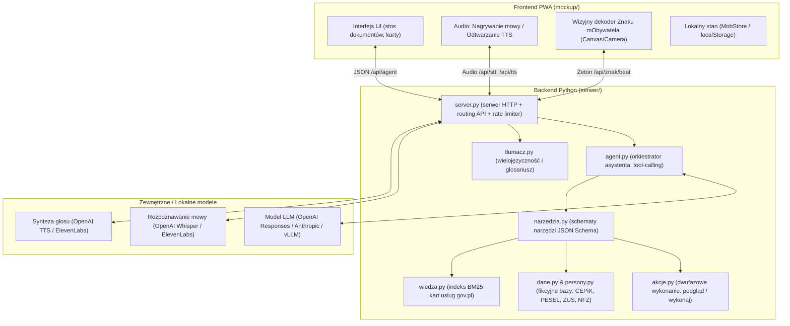

# mObywatel.ai: prototyp asystenta zintegrowanego z aplikacją

Prototyp aplikacji mObywatel nowej generacji, w której tradycyjne menu, podstrony i formularze urzędowe zostały zastąpione konwersacyjnym **asystentem AI** (tekstowym i głosowym). Asystent weryfikuje uprawnienia w rejestrach, przeszukuje bazy wiedzy gov.pl i przygotowuje sprawy urzędowe, a użytkownik każdą czynność prawną lub finansową autoryzuje biometrycznie (Face ID / PIN) na dedykowanej karcie potwierdzenia.

Projekt zawiera kompletną implementację: serwer w czystym Pythonie (zero zależności zewnętrznych, brak wymogu `pip install`), silnik wywoływania narzędzi (tool-calling), integrację z modelami LLM (OpenAI, Anthropic, modele lokalne vLLM/Ollama), syntezę i rozpoznawanie mowy oraz interfejs graficzny PWA z autorskim mechanizmem **Znaku mObywatela**.

> [!IMPORTANT]
> **Projekt badawczo-demonstracyjny.** Wszystkie dane (persony, numery PESEL, dowody osobiste, pojazdy, mandaty, konta bankowe) są całkowicie fikcyjne. Prototyp nie łączy się z żadnym systemem państwowym i nie wolno w nim wprowadzać prawdziwych danych osobowych.

---

## Spis treści
1. [Architektura systemu: jak to działa](#architektura-systemu-jak-to-działa)
2. [Przewodnik po strukturze kodu](#przewodnik-po-strukturze-kodu)
   - [Frontend (`mockup/`)](#frontend-mockup)
   - [Backend (`serwer/`)](#backend-serwer)
3. [Kluczowe mechanizmy w kodzie](#kluczowe-mechanizmy-w-kodzie)
   - [Wzorzec dwufazowego potwierdzania akcji (Action Confirmation)](#1-wzorzec-dwufazowego-potwierdzania-akcji-action-confirmation)
   - [Znak mObywatela (zamiast statycznych kodów QR)](#2-znak-mobywatela-zamiast-statycznych-kodów-qr)
   - [Baza wiedzy i wyszukiwarka BM25 bez bazy wektorowej](#3-baza-wiedzy-i-wyszukiwarka-bm25-bez-bazy-wektorowej)
   - [Wielojęzyczność i glosariusz](#4-wielojęzyczność-i-glosariusz)
4. [Wymagania i instalacja](#wymagania-i-instalacja)
5. [Uruchomienie](#uruchomienie)
   - [Tryb demonstracyjny / offline (bez kluczy API)](#tryb-demonstracyjny--offline-bez-kluczy-api)
   - [Z modelami chmurowymi (OpenAI, Anthropic, ElevenLabs)](#z-modelami-chmurowymi-openai-anthropic-elevenlabs)
   - [Z polskimi modelami lokalnymi (Bielik, PLLuM, Ollama, vLLM)](#z-polskimi-modelami-lokalnymi-bielik-pllum-ollama-vllm)
   - [Uruchomienie w Dockerze](#uruchomienie-w-dockerze)
6. [Konfiguracja zmiennych środowiskowych](#konfiguracja-zmiennych-środowiskowych)
7. [Testy automatyczne](#testy-automatyczne)
8. [Bezpieczeństwo i licencja](#bezpieczeństwo-i-licencja)

---

## Architektura systemu: jak to działa

Aplikacja opiera się na architekturze klient-serwer ze ścisłym podziałem ról:



---

## Przewodnik po strukturze kodu

### Frontend (`mockup/`)

Interfejs aplikacji mobilnej wykonany w czystym HTML5, CSS i vanillowym JavaScript (bez ciężkich frameworków):

| Plik | Za co odpowiada w kodzie |
|---|---|
| `index.html` | Główny szkielet aplikacji: ramka telefonu, pasek statusu, nagłówek, dynamiczny stos dokumentów (`#stack`), panel asystenta (`#chat`), nawigacja dolna (`#bnav`). |
| `komputer.html` | Symulacja ekranu komputera (np. w urzędzie lub sklepie internetowym) wyświetlająca Znak mObywatela do zeskanowania telefonem. |
| `style.css` | Kompletny arkusz stylów: tokeny projektowe, animacje stosu, container queries, responsywność, tryby wysokiego kontrastu oraz motyw ciemny/jasny. |
| `core.js` | Rdzeń aplikacji: logika stosu kart (`renderStack`, pozycjonowanie i animacja przy redukcji wysokości `short-card`), zegar czasu rzeczywistego, obsługa otwierania i zamykania szczegółów dokumentu. |
| `agent.js` | Obsługa czatu z asystentem AI: wysyłanie wiadomości do `/api/agent`, kolejkowanie odpowiedzi, nagrywanie dźwięku z mikrofonu (`MediaRecorder`), odtwarzanie mowy z `/api/tts`, obsługa kart potwierdzenia akcji oraz synchronizacja stanu z `MobStore`. |
| `znak-kod.js` | Matematyczno-wizyjny algorytm Znaku mObywatela: kodowanie 16-bitowego żetonu w 32 kropkach wokół godła z sumą CRC10, generowanie SVG oraz dekoder wizyjny (szukanie czerwonego godła w klatce wideo, korekcja perspektywy, próbkowanie kołowe i weryfikacja CRC). |
| `znak.js` | Przepływ obsługi kamery i skanera: dostęp do `getUserMedia`, obsługa trybów „Przekaż dane” i „Przyjmij dane”, odpytywanie serwera o status żetonu (`/api/znak/beat`), powiększanie Znaku na mDowodzie. |
| `osoby.js` | Fikcyjna baza 4 tożsamości demonstracyjnych (Marta Kowalska, Jan Wiśniewski, Ewa Nowak, Kacper Zieliński) wraz z ich dokumentami, numerami PESEL, pojazdami i powiadomieniami. |
| `scenarios.js` | Silnik scenariuszy demonstracyjnych: pozwala testować aplikację w trybie czysto skryptowym, gdy serwer działa bez zewnętrznych kluczy API. |
| `accessibility.js` | Standardy WCAG 2.1 AA: komunikaty dla czytników ekranu (`aria-live`), pułapki fokusu klawiatury (`focus trapping`), skróty klawiszowe, powiększanie tekstu, wysoki kontrast oraz moduł `MobStore` (pamięć podręczna ustawień i stanu w `localStorage`). |
| `variants.js` | Alternatywne układy prezentacji portfela dokumentów (widok karuzeli poziomej, lista pionowa, kafelki siatki). |
| `uslugi.js` | Katalog spraw i e-usług publicznych, wyszukiwarka usług oraz podgląd procedur. |
| `poczta.js` | Skrzynka e-Doręczeń: odbiór pism urzędowych, podgląd treści wezwań, terminy odpowiedzi i obsługa załączników. |
| `ikp-integracja.js` | Internetowe Konto Pacjenta: aktywne e-recepty, e-skierowania, karta DiLO, status ubezpieczenia NFZ (eWUŚ) oraz widok apteczny. |
| `mandaty.js` | Moduł punktów karnych i mandatów: historia wykroczeń drogowych, terminy przedawnienia punktów, instrukcje opłacania mandatów. |
| `katalog-kart.js` | Dodawanie kolejnych dokumentów do portfela (mLegitymacja studencka/szkolna, Karta Dużej Rodziny, prawo jazdy, PWZ lekarza, itp.). |
| `sylwetki.js` | Parametryczny generator sylwetek pojazdów w SVG: na podstawie marki i modelu z CEPiK rysuje wierną sylwetkę nadwozia w barwach z rejestru. |
| `spotlight.js` | Globalna wyszukiwarka Spotlight: przeszukiwanie dokumentów, usług, spraw i przepisów z poziomu jednego pola. |
| `powiadomienia-eksport.js` | System powiadomień push/in-app, eksport terminów do kalendarza (`.ics`) oraz generowanie i pobieranie zaświadczeń w formacie PDF. |
| `i18n.js` | Klient tłumaczeń interfejsu: dynamiczne pobieranie słowników z `/api/i18n` i podmiana tekstów w DOM. |
| `sw.js` | Service Worker zapewniający działanie offline (PWA) i cache'owanie zasobów statycznych. |

---

### Backend (`serwer/`)

Backend zrealizowany w bibliotece standardowej Pythona (`http.server`, `urllib`, `json`, `sqlite3` / pamięć RAM), bez potrzeby instalowania zewnętrznych pakietów pip:

| Plik | Za co odpowiada w kodzie |
|---|---|
| `server.py` | Serwer HTTP i router API. Obsługuje kompresję gzip, etagi, nagłówki bezpieczeństwa (CSP, `X-Frame-Options`), mechanizm token bucket rate limitera chroniący przed przeciążeniem oraz endpointy: `/api/agent`, `/api/stt`, `/api/tts`, `/api/znak/*`, `/api/i18n/*`. |
| `agent.py` | Orkiestrator asystenta konwersacyjnego. Buduje prompt systemowy, zarządza historią rozmowy, wykonuje pętlę wywołań narzędzi (tool-calling loop), obsługuje API OpenAI (Responses / Chat Completions), Anthropic Messages API lub lokalne serwery OpenAI-compatible. |
| `narzedzia.py` | Deklaracja kontraktu narzędzi (JSON Schema) dla modeli językowych: podział na odczyty (`ODCZYTY`), akcje prawne (`AKCJE`) oraz akcje interfejsu użytkownika (`UI`). |
| `akcje.py` | Wykonawcza warstwa biznesowa dla czynności ze skutkiem prawnym lub finansowym (zastrzeżenie PESEL, opłacenie podatku, wniosek o dowód, zgłoszenie zbycia auta, oświadczenie kolizji mStłuczka). Realizuje kontrakt `podglad()` -> karta potwierdzenia oraz `wykonaj()` -> wynik. |
| `dane.py` | Fikcyjne rejestry państwowe: implementacja narzędzi odczytowych pobierających dane z wirtualnych baz PESEL, CEPiK, CEIDG, ZUS, Urzędu Skarbowego, bazy mandatów i recept. |
| `persony.py` | Definicje tożsamości testowych po stronie serwera wraz z ich powiązaniami rodzinnymi, majątkowymi i statusami urzędowymi. |
| `wiedza.py` | Silnik wyszukiwarki procedur urzędowych bazujący na indeksie odwróconym i algorytmie BM25/TF-IDF, przeszukujący lokalne pliki JSONL z bazy `serwer/wiedza/`. |
| `tlumacz.py` | Moduł dynamicznego tłumaczenia rozmowy w locie: tłumaczy zapytania użytkownika na język polski dla asystenta, a odpowiedzi z powrotem na język obcy z zachowaniem terminologii urzędowej z glosariusza. |
| `test_api.py` | Testy integracyjne API serwera: weryfikacja nagłówków bezpieczeństwa, rate limitera, sanityzacji PII, odporności na błędy i poprawności endpointów. |
| `test_agent.py` | Testy jednostkowe integracji z klientami modeli LLM i obsługi wywołań narzędzi. |

---

## Kluczowe mechanizmy w kodzie

### 1. Wzorzec dwufazowego potwierdzania akcji (Action Confirmation)

Asystent AI nie ma prawa bezpośrednio zmienić stanu prawnego ani zainicjować przelewu bez wiedzy użytkownika. W kodzie zrealizowano to przez wzorzec dwóch faz w [serwer/akcje.py](file:///home/bartosz/mObywatel/mObywatel/serwer/akcje.py):

1. **Faza 1 – Podgląd (`podglad(argumenty, stan)`):**
   Gdy model decyduje o wykonaniu akcji (np. `zaplac`, `zastrzez_pesel`), funkcja generuje kartę potwierdzenia (`typ: "potwierdzenie"`), zawierającą parametry operacji, kwotę, odbiorcę i ostrzeżenia. Model zatrzymuje wypowiedź i czeka na reakcję człowieka.
2. **Faza 2 – Autoryzacja i Wykonanie (`wykonaj(argumenty, stan)`):**
   Dopiero gdy użytkownik w interfejsie zatwierdzi kartę (np. biometrią Face ID w telefonie), klient wysyła sygnał potwierdzenia do `/api/agent`. Backend uruchamia właściwą funkcję `wykonaj()`, zapisuje skutek w stanie i zwraca kartę potwierdzenia odbioru / urzędowego poświadczenia przedłożenia.

### 2. Znak mObywatela (zamiast statycznych kodów QR)

Prototyp rezygnuje z tradycyjnych kodów QR na rzecz dynamicznego, rotującego identyfikatora wizualnego:
* **Kodowanie ([mockup/znak-kod.js](file:///home/bartosz/mObywatel/mObywatel/mockup/znak-kod.js)):** 16-bitowy token zmieniający się co kilka sekund, kodowany na okręgu z 32 punktów (6 bitów synchronizacji `111110`, 16 bitów tokenu, 10 bitów sumy kontrolnej CRC10). W środku znajduje się godło mObywatela.
* **Dekodowanie wizyjne:** Algorytm w JS pobiera klatkę z kamery w elemencie `<canvas>`, wyszukuje czerwony obszar godła, wyznacza środek i osie z momentów bezwładności (odporność na obrót i pochylenie perspektywiczne), próbkuje kropki po elipsie i sprawdza CRC.
* **Bezpieczeństwo:** Kod rotuje na bieżąco za pośrednictwem endpointu `/api/znak/beat` w [serwer/server.py](file:///home/bartosz/mObywatel/mObywatel/serwer/server.py), co uniemożliwia sfotografowanie ekranu i ponowne użycie tego samego znaku.

### 3. Baza wiedzy i wyszukiwarka BM25 bez bazy wektorowej

W module [serwer/wiedza.py](file:///home/bartosz/mObywatel/mObywatel/serwer/wiedza.py) zaimplementowano lokalną wyszukiwarkę pełnotekstową:
* Indeksuje setki oficjalnych kart usług publicznych (z `serwer/wiedza/cards.jsonl` i `fakty_cards.jsonl`).
* Wykorzystuje odwrócony indeks wyrazów i scoring BM25/TF-IDF.
* Działa błyskawicznie w pamięci RAM, nie wymaga zewnętrznych baz wektorowych (Pinecone, Chroma), bibliotek Pythona ani połączenia z internetem.

### 4. Wielojęzyczność i glosariusz

Aplikacja obsługuje 15 języków:
* Interfejs statyczny tłumaczony jest przez pliki JSON w `serwer/i18n/`.
* Rozmowa z asystentem tłumaczona jest w locie przez [serwer/tlumacz.py](file:///home/bartosz/mObywatel/mObywatel/serwer/tlumacz.py). Aby model nie przekręcał specyficznych polskich pojęć prawnych (np. *PESEL*, *Karta Dużej Rodziny*, *mDowód*, *CEPiK*), tłumacz otrzymuje glosariusz z `serwer/glosariusz/`, wymuszający właściwe nazewnictwo w danym języku.

---

## Wymagania i instalacja

* **Python:** 3.9 lub nowszy (systemy Linux, macOS, Windows).
* **Zależności:** brak (wyłącznie biblioteka standardowa Pythona).
* **Przeglądarka internetowa:** obsługa standardów nowoczesnego JS i Web Audio API (dostęp do mikrofonu wymaga adresu `localhost`/`127.0.0.1` lub połączenia HTTPS).
* **Opcjonalnie:** Docker oraz Docker Compose.

---

## Uruchomienie

### Tryb demonstracyjny / offline (bez kluczy API)

Aplikację można uruchomić bez podawania jakichkolwiek kluczy API:
```bash
python3 serwer/server.py
```
Aplikacja uruchomi się pod adresem: **http://127.0.0.1:8790/aplikacja**  
W tym trybie asystent działa w oparciu o gotowe scenariusze demonstracyjne ze skryptu ([mockup/scenarios.js](file:///home/bartosz/mObywatel/mObywatel/mockup/scenarios.js)).

Dostępny jest także ekran symulacji komputera urzędowego do testowania skanowania Znaku mObywatela:
**http://127.0.0.1:8790/komputer**

---

### Z modelami chmurowymi (OpenAI, Anthropic, ElevenLabs)

1. Skopiuj plik konfiguracyjny środowiska:
   ```bash
   cp .env.example .env
   ```
2. Wpisz swoje klucze w pliku `.env`:
   ```bash
   OPENAI_API_KEY="sk-..."
   ELEVENLABS_API_KEY="..."   # opcjonalnie: wyższa jakość głosu
   ```
3. Uruchom serwer ze zmiennymi środowiskowymi:
   ```bash
   set -a; . ./.env; set +a; python3 serwer/server.py
   ```

---

### Z polskimi modelami lokalnymi (Bielik, PLLuM, Ollama, vLLM)

Asystent współpracuje z lokalnymi modelami wspierającymi wywoływanie narzędzi (Tool Calling) przez interfejs zgodny z OpenAI (`/v1/chat/completions`):

```bash
export PROVIDER=zgodny
export OPENAI_BASE_URL="http://127.0.0.1:8000/v1"   # adres instancji vLLM lub Ollama (11434)
export MODEL="nazwa-twojego-modelu"
export MODEL_API_KEY="brak-lub-klucz"
python3 serwer/server.py
```

> [!TIP]
> Przy podpinaniu modeli lokalnych upewnij się, że silnik (np. vLLM) ma włączoną flagę parsowania wywołań funkcji (`--enable-auto-tool-choice --tool-call-parser ...`), ponieważ asystent opiera całe działanie o narzędzia.

---

### Uruchomienie w Dockerze

```bash
cp .env.example .env
docker compose up --build
```
Kontener wystawi aplikację na porcie `8790` pod adresem `http://127.0.0.1:8790/aplikacja`.

---

## Konfiguracja zmiennych środowiskowych

| Zmienna | Domyślna wartość | Opis |
|---|---|---|
| `HOST` | `127.0.0.1` | Adres nasłuchu serwera (w Dockerze: `0.0.0.0`). |
| `PORT` | `8790` | Port HTTP serwera. |
| `PROVIDER` | `openai` | Wybór dostawcy LLM: `openai`, `anthropic` lub `zgodny`. |
| `OPENAI_API_KEY` | *(brak)* | Klucz do API OpenAI (asystent, transkrypcja Whisper, synteza głosu). |
| `OPENAI_MODEL` | `gpt-6-luna` | Nazwa modelu OpenAI dla asystenta. |
| `OPENAI_TIER` / `OPENAI_EFFORT` | `fast` / `low` | Parametry wydajnościowe zapytań OpenAI. |
| `ANTHROPIC_API_KEY` | *(brak)* | Klucz do API Anthropic (dla `PROVIDER=anthropic`). |
| `MODEL` | *(brak)* | Identyfikator modelu przy `PROVIDER=zgodny` lub `anthropic`. |
| `OPENAI_BASE_URL` | `https://api.openai.com/v1` | URL bazowy API zgodnego z OpenAI. |
| `ELEVENLABS_API_KEY` | *(brak)* | Klucz ElevenLabs do polskiej syntezy mowy i rozpoznawania mowy. |
| `EL_VOICE` | *(domyślny)* | Identyfikator wybranego głosu w ElevenLabs. |
| `TLUMACZ_MODEL` | `gpt-6-luna` | Model używany do tłumaczenia rozmowy w locie. |
| `AGENT_LOG` | `serwer/agent.log` | Ścieżka do pliku rejestru zdarzeń asystenta. |

---

## Testy automatyczne

Pakiet zawiera zestaw testów regresyjnych sprawdzających poprawność działania API, nagłówków, mechanizmów ochronnych i logiki asystenta:

```bash
python3 -m unittest discover -s serwer -v
```

Testy pokrywają m.in.:
* Działanie rate limitera i zwalnianie pamięci przy dużej liczbie unikalnych IP,
* Sanityzację i maskowanie tokenów PII (PESEL, dowody osobiste, klucze API) w logach,
* Odporność endpointu `/api/agent` na niepoprawny stan klienta lub błędy narzędzi,
* Zwracanie nagłówków ochronnych (`Content-Security-Policy`, `X-Frame-Options`, `X-Content-Type-Options`).

---

## Bezpieczeństwo i licencja

* **Prywatność:** Serwer domyślnie nasłuchuje wyłącznie na interfejsie lokalnym `127.0.0.1`. Nie wystawiaj serwera bezpośrednio do publicznej sieci bez uwierzytelnienia i szyfrowania HTTPS.
* **Logi:** Dziennik zdarzeń `serwer/agent.log` automatycznie anonimizuje i wycina wykryte numery PESEL, numery dowodów, telefony, maile i klucze API.
* **Licencja:** Kod prototypu (pliki `.py`, `.js`, `.html`, `.css`, testy i konfiguracje) udostępniony jest na licencji **MIT** (szczegóły w pliku [LICENSE](file:///home/bartosz/mObywatel/mObywatel/LICENSE)).
* **Wyłączenia z licencji MIT:**
  - Nazwa, logotyp i znaki towarowe aplikacji mObywatel oraz Godło RP podlegają właściwym przepisom prawa i prawom ich dysponentów.
  - Zdjęcia demonstracyjne i fragmenty opisów usług z portalu gov.pl służą celom badawczo-pokazowym.
